# 更新日志

[English](./CHANGELOG.md) | [简体中文] | [日本語](./CHANGELOG_ja.md)

本文件记录本项目所有值得关注的变更。

格式基于 [Keep a Changelog](https://keepachangelog.com/zh-CN/1.0.0/)，版本号遵循[语义化版本](https://semver.org/lang/zh-CN/)。

## [0.5.3] - 2026-10-14

### 添加
- **新增角色阿俊（Arjun）**：添加角色头像、立绘和专属配色，并加入随机角色池。

## [0.5.2] - 2026-10-05

### 添加
- **回放分析升级为历史列表与侧边详情**：集中查看本机提交过、以及成功查看过的回放分析，支持按玩家名、CFN 或回放 ID 搜索，按角色和状态筛选。未完成任务的进度在后台同步；点击记录即可在侧边抽屉查看详情。
   🙌 特别感谢 焕冥 提供的建议
  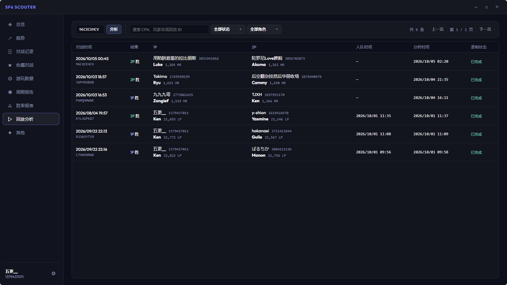
- **添加回放分析入口**： 可通过对战记录，收藏回放右键直接开始进入回放分析页面
 🙌 特别感谢 QQ 焕冥, QQ 痛饮三杯 提供的建议
- **回放分析导出回放分析数据**：打开回放分析详情，在“状态”中选择“导出回放分析数据”，即可保存包含对局数据和复盘提示词的 Markdown 文件，交给你常用的 AI 继续分析。
  🙌 特别感谢 QQ 痛饮三杯 提供的建议
  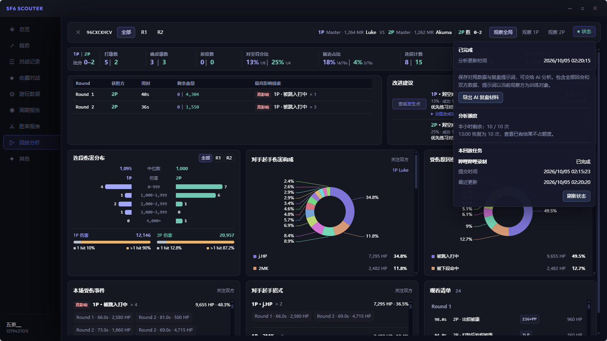

- **按伤害优先级给出改进建议**：整场总览新增“改进建议”，从对空、被确反、应对迸发、抢招被打康和被差合等已记录问题中，优先展示关联伤害较高的复盘重点，帮助决定先练什么。

- **新增赞助入口**：可在系统设置中找到赞助链接，支持 SF6Scouter 的持续开发。
### 优化

- **更细的起手与伤害分析**：新增对手起手招式统计；“附近事件”新增整段受伤结束后的剩余血量。
  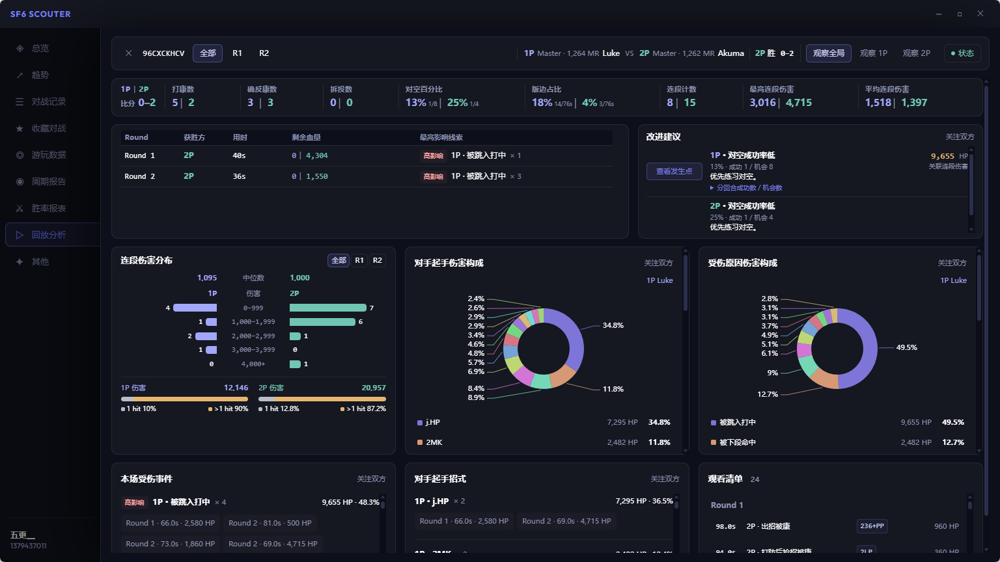
  🙌 特别感谢 QQ 悠哈, QQ 太简单, QQ 无道, QQ 此路<-不通 提供的建议
- **从分数趋势直接查看逐局表现**：MR／LP 趋势图保留整体曲线，放大到足够细的范围后显示对手角色头像，以绿框／红框区分胜负，下方对战记录随可见范围联动。新增放大、缩小、总览按钮，支持横向拖选放大、Ctrl + 拖动或滚轮平移；逐局视图使用更细的数值刻度，方便观察小幅变化。
  🙌 特别感谢 QQ balance 提供的建议
  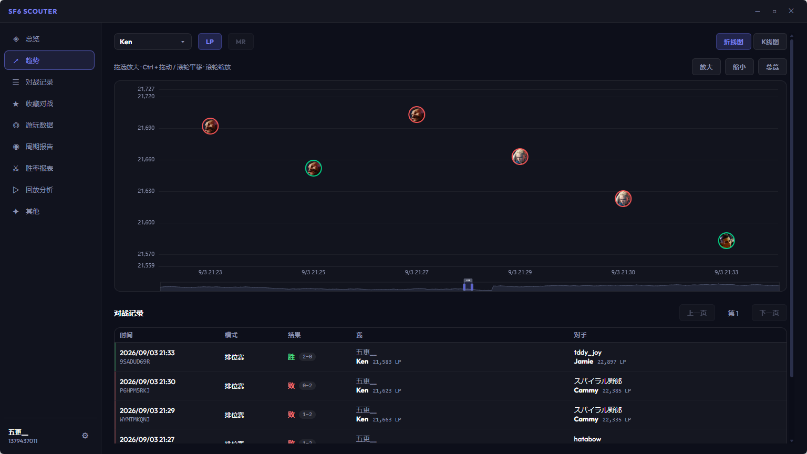

- **对战信息更易读**：统一对战记录、收藏对战和回放分析列表的双行玩家信息与胜负标识；对战记录和收藏对战的筛选栏、表头保持可见，记录在表格内滚动。

## [0.5.1] - 2026-09-25

### 修复
- **修复后台窗口抢夺游戏焦点的问题**：解决后台获取数据、同步段位信息或检测网络连接时，窗口可能抢占游戏焦点、打断操作的问题。
  🙌 特别感谢 QQ www.TH.zz提供的反馈

## [0.5.0] - 2026-09-24

### 添加
- **云端回放分析**：在 Home 页面的“回放分析”中输入回放 ID，即可查询已有分析或提交新的分析任务；也可以在“对战记录”和“收藏对战”中右键选择“回放分析”，快速打开对应对局。
  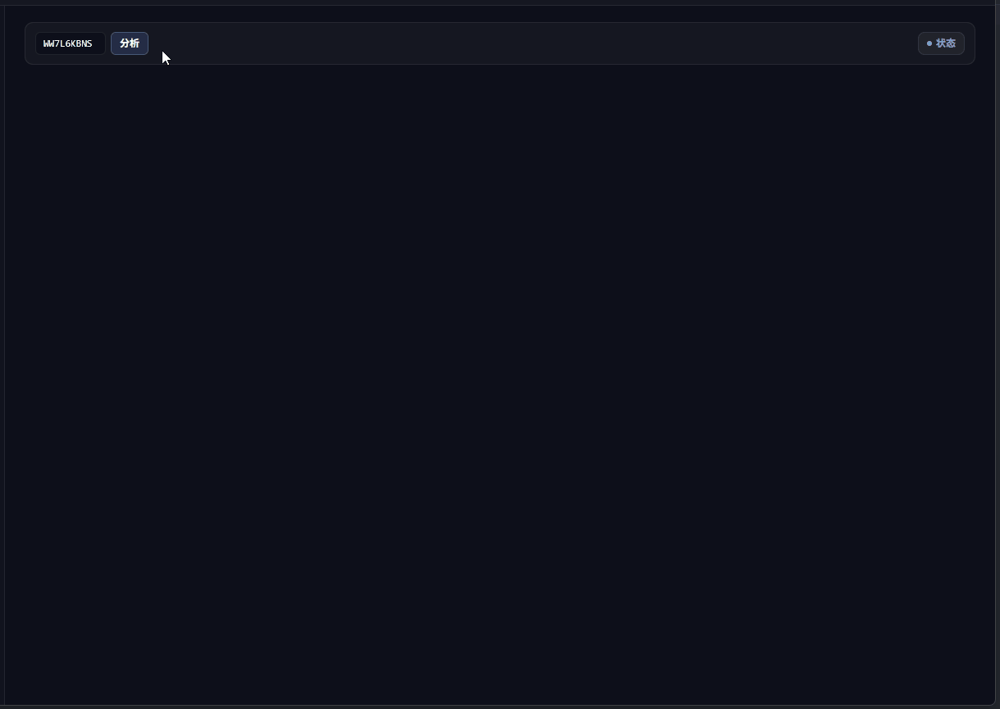

- **整场复盘概览**：集中查看各回合胜负、受伤事件和连段伤害分布，按事件的出现次数与累计伤害标注相对影响等级，帮助确定复盘重点。支持按问题筛选观看清单，点击具体记录即可跳转到对应回合。

- **回合时间轴与数据联动**：同屏查看双方血量、斗气和场上位置的变化，以及受伤事件、连段伤害与命中数。点击图表或记录即可定位相关时点，并查看附近事件；支持切换关注 1P 或 2P，结合对空率、拆投、版边时间等统计逐回合复盘。

- **分析进度与额度提示**：在“状态”中查看任务进度，分析完成后自动展示结果，失败时可重试。每台设备每小时可主动提交最多 10 次分析，每到整点恢复额度；查询和查看已有结果不消耗次数。

### 特别感谢
- 🙌 特别感谢 QQ 悠哈、QQ 太简单、QQ 冥、QQ 无道，以及 QQ 群“SF Scouter 战绩面板内测群”的各位老哥，感谢大家的细心解答与思路启发。
- 🙌 感谢 [SF6_Tools](https://github.com/Wael3rd/SF6_Tools)（[Nexus Mods](https://www.nexusmods.com/streetfighter6/mods/3173)）、[sf6_re_scripts](https://github.com/lucasteles/sf6_re_scripts) 和 [SF6Mods](https://github.com/WistfulHopes/SF6Mods) 项目带来的思路启发。

## [0.4.9] - 2026-09-22

### 新增
- **登录状态自动校验与错误提示**：自动校验登录状态，并在校验异常时显示错误提示，方便了解当前登录状态及异常情况。

### 优化
- **优化重置跟踪分数的提示文案**：调整重置跟踪分数相关话术，让操作含义更清晰。

### 修复
- **修复长时间对战后抢夺游戏焦点的问题**：解决 SF6Scouter 在对战约一小时后抢占游戏窗口焦点、打断操作的问题。
  🙌 特别感谢 QQ 此路<-不通提供的反馈
- **修复复盘标签遮挡窗口内点击的问题**：解决复盘标签遮挡窗口内其他区域、导致点击操作受阻的问题。
  🙌 特别感谢 QQ 焕冥 提供的反馈
- **修复窗口无法正常关闭的问题**：解决窗口无法正常关闭的问题。
  🙌 特别感谢 QQ 啊？提供的反馈

## [0.4.8] - 2026-08-04

### 添加
- **支持收藏对战记录与添加复盘标记**：新增对战记录收藏功能。用户可以在复盘标签弹窗中直接收藏对战记录，也可以在对战记录列表中右键收藏；收藏的对战记录可在 Home 页面的“收藏对战”页面查看。
  🙌 特别感谢 QQ 焕冥 提供的建议
- **支持新角色 Yasmine**：新增 Yasmine 的数据和图片显示支持。

### 修复
- **修复 OCR 设置首次启动时不生效的问题**：解决 OCR 设置在应用首次启动时未正确生效的问题。
  🙌 特别感谢 QQ 宇宙最酷 提供的反馈

## [0.4.7] - 2026-07-23

### 修复
- **修复Pro面板和Mini面板无法关闭的问题**：解决了修复Pro面板和Mini面板无法关闭，关闭后有透明边框的问题。
  🙌 特别感谢 QQ 马肯博, QQ 啊？提供的反馈

## [0.4.6] - 2026-07-21

### 修复
- **修复弹窗抢夺游戏焦点的问题**：解决了弹窗意外抢占游戏窗口焦点、导致操作被打断的问题。
  🙌 特别感谢 QQ 木慕水 协助的测试
  🙌 特别感谢 QQ 太简单, QQ tainanle, QQ Raising, QQ 水蓝蓝，微信 且胆行 提供的反馈

## [0.4.5] - 2026-07-09

### 优化
- **趋势图支持显示段位文本**：LP 趋势图的 Y 轴现已显示对应段位文本，查看分数走势时也能更直观地了解当前所处分段。
  🙌 特别感谢 QQ Kano、QQ 宇宙最酷、QQ 啊？ 提供的反馈

- **趋势图仅统计排位数据**：趋势图现仅统计排位数据，避免非排位对局对趋势图的影响。
  🙌 特别感谢 NGA 贫穷的吸血鬼 提供的反馈

- **防上头提醒改为独立窗口提示**：防上头提醒现以独立窗口形式展示，提示更醒目、不易错过；如不需要，也可在“设置 - 数据”中关闭。
  🙌 特别感谢 QQ 键、QQ 游历群星 提供的反馈

- **优化更新提示与交互流程**：改进更新模块的提示文案与交互体验。现在点击更新后会先展示版本更新内容，再由用户决定是否继续，而不是直接进入更新流程。
  🙌 特别感谢 QQ 此路<-不通 提供的反馈

- **降低应用闲置时的内存占用**：进一步优化内存管理，让应用在闲置状态下的内存占用更稳定，也更合理。
  🙌 特别感谢 QQ 此路<-不通 提供的反馈

- **复盘标签新增**：新增「瞎按」复盘标签。
  🙌 特别感谢 QQ 啊？ 提供的反馈

## [0.4.4] - 2026-06-29

### 修复
- **修复对战记录和胜率报表中模式选项展示的错误**：修复对战记录的模式信息展示错误和胜率报表中模型下拉选项的错误
  🙌 特别感谢 NGA langxiankui 提供的反馈

## [0.4.3] - 2026-06-28

### 添加
- **胜率报表面板**：新增胜率报表页，可查看不同模式的对战数据，查看对战 KPI 数据（胜率、场次、连胜 / 连败记录等）。
  🙌 特别感谢 QQ 焕冥 提供的反馈
  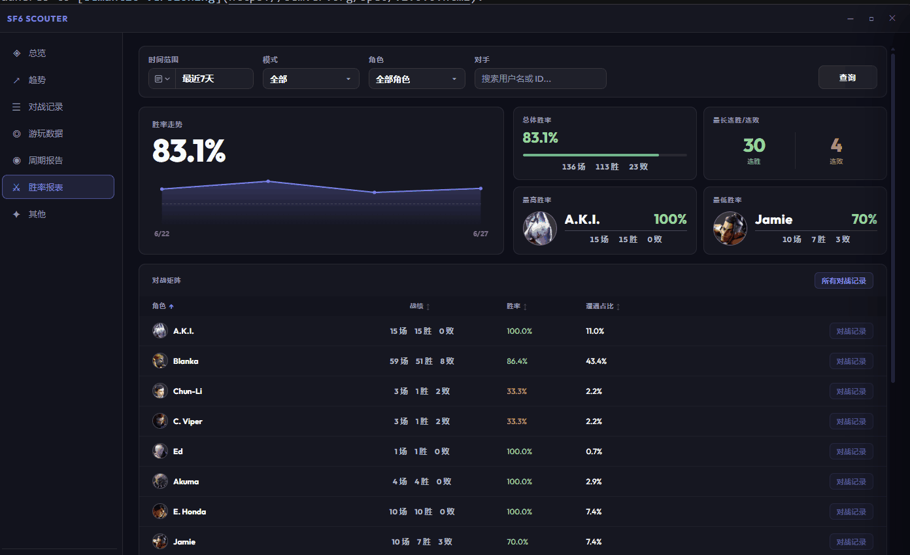

- **对战记录筛选条件**：添加多种筛选条件，方便用户快速查找目标对战记录。
  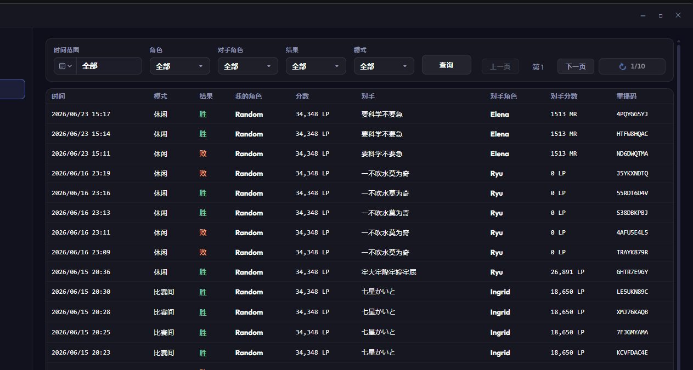

- **对战记录复盘标签**：在对战记录表格中右键单击任意对局，可直接为其添加复盘标签。
  🙌 特别感谢 QQ 宇宙最酷，QQ 林无穷，QQ 觿子 提供的灵感启发
  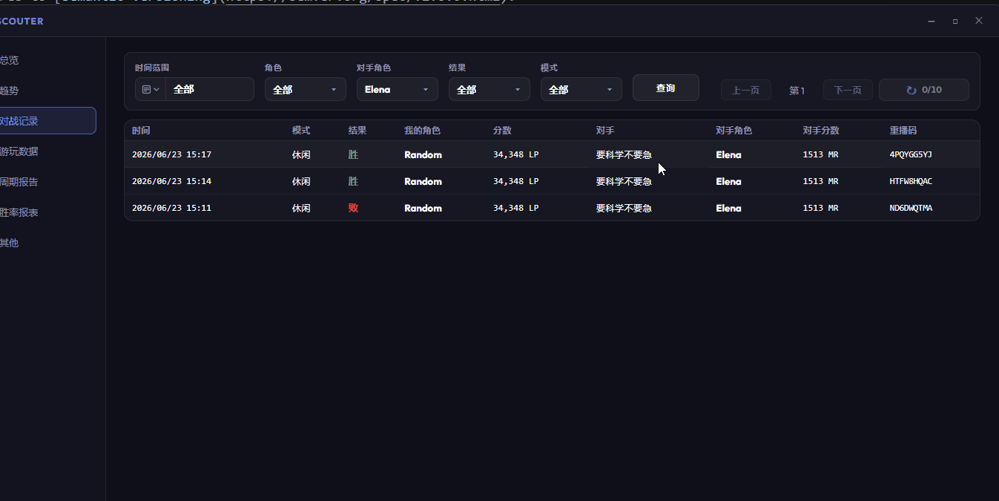

- **对局抽屉标签快速入口**：在对局详情抽屉中展示前 5 个高频复盘标签，点击可一键联动筛选对应对局。
  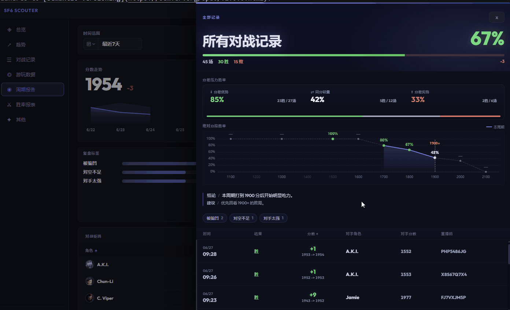

- **历史对战记录主动同步**：在对战记录表格右上角新增主动同步入口，可查看历史同步状态。
  🙌 特别感谢 QQ 浅海 提供的反馈
  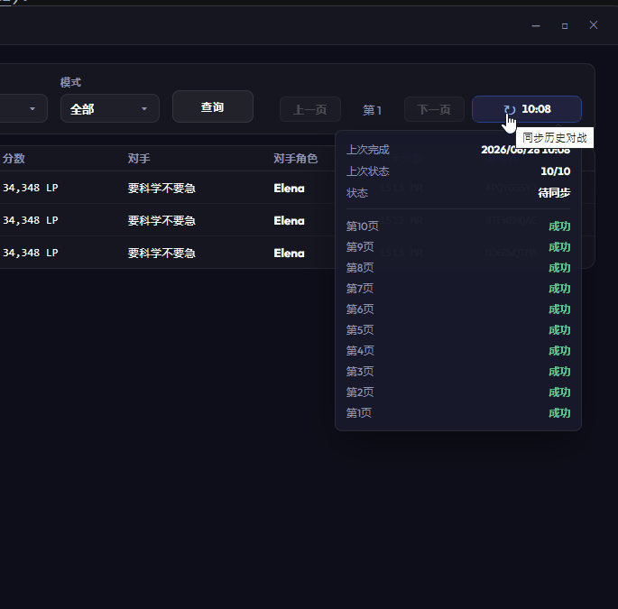

### 优化
- **复盘标签新增**：新增「一直被投」和「迸发没反应」两个复盘标签。
  🙌 特别感谢 NGA 智障的最高境界, NGA langxiankui, QQ K丶越 提供的反馈

### 修复
- **修复 Windows 10 减少动效时抽屉始终展开**：解决在系统开启「减少特效」时侧边抽屉始终处于展开状态的异常行为。
  🙌 特别感谢 QQ 泠㳕 提供的反馈
- **修复复盘提示始终展开**：复盘提示现可按配置正确关闭展示。
  🙌 特别感谢 QQ 此路<-不通 提供的反馈

## [0.4.2] - 2026-06-11

### 添加
- **新增排位 BO3 快速复盘功能**: 当完成一次排位 BO3 且结果为负时，系统将自动弹出标签窗口，方便用户进行快速、简单的赛后复盘。收集的复盘标签数据将在周期报表中汇总展示，助您更好地总结对战经验。该功能可在“设置 - 数据 - 对战复盘提示”中关闭。
  🙌 特别感谢 QQ 宇宙最酷，QQ 林无穷，QQ 觿子 提供的灵感启发
  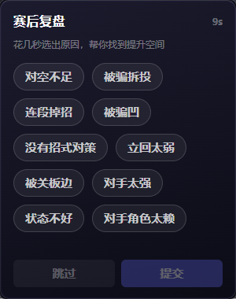
  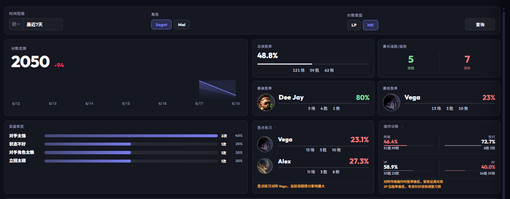
- **新增跟踪目标历史记录功能**: 应用会自动记忆最近输入过的跟踪目标（最多 5 个），后续在输入时可直接点击选择，无需重复手动输入 CFN ID。
  🙌 特别感谢 QQ 游历群星，QQ 焕冥 提供的反馈

- **新增“防上头提醒”开关**：在“设置 - 数据”页面中加入了防上头提醒开关，用户可根据自身需求自由开启或关闭该功能。
  🙌 特别感谢 小黑盒 糖泥呵 提供的建议

### 优化
- **限制应用单实例运行**：新增了应用单开限制，避免因误操作同时打开多个应用实例，从而影响系统性能和使用体验。 
  🙌 特别感谢 QQ ……, QQ 浅海 提供的反馈

- **内存占用深度优化**：优化了应用的内存管理，修复了特定场景下内存占用异常增加的问题。 
  🙌 特别感谢 QQ 此路<-不通 提供的反馈

- **数据共享网络优化**：精简了数据上传逻辑，有效减少了请求次数和网络资源占用。

### 修复
- **修复备份文件加载失败**：解决了部分情况下备份文件无法正常加载的问题。
  🙌 特别感谢 QQ 浅海 提供的反馈

## [0.4.1] - 2026-06-10

### 添加

- **游玩数据支持查看对战胜率**: 在“Home-游玩数据”中点击特定角色，即可查看该角色对战其他各角色的胜率。
  
- **新增网络连接测试**: 在“设置-账号”中添加网络测试功能，可检测当前环境与官网的连接质量，协助诊断网络问题。
  🙌 特别感谢 QQ 宇宙最酷 提供的建议

- **Home 页面支持缩放**：用户可以使用 `Ctrl + 滚轮` 来放大或缩小页面，提升交互体验。
  🙌 特别感谢 QQ 此路<-不通 提供的建议
  

- **新增随机角色推荐**：在“Home-其他”页面中点击“随机角色”按钮即可获得推荐。该功能各角色出现概率均等。
  🙌 特别感谢 QQ 王小川 提供的建议
  

### 优化

- **周期报表支持自定义时间查询**：支持自定义时间范围查找，满足不同场景下的查询需求（单次查询跨度最大为 30 天）。
  🙌 特别感谢 NGA 智障的最高境界, QQ 浅海 提供的反馈
  

- **DPI 适配优化**：优化了应用在高 DPI 屏幕上的显示效果，确保界面元素清晰且布局合理。
  🙌 特别感谢 QQ Kano 提供的反馈

- **Home 页面支持记忆上次选项**：自动记录侧边栏的上次选择，避免重复操作，提升使用体验。
  🙌 特别感谢 QQ 浅海, QQ❄ 提供的建议

### 修复
- **修复跟踪起点角色列表为空的问题**：解决了特定情况下跟踪起点角色列表显示为空的故障。
  🙌 特别感谢 QQ w158 提供的反馈

## [0.4.0] - 2026-06-03

### 添加

- **添加防上头助手**：当用户在短时间内连续输掉多场比赛时，系统会弹出一个提示窗口，建议用户休息一下，避免因为上头连续掉分。
  🙌 特别感谢 QQ 看不腻的唐, QQ 第一百零五天, QQ 踢, QQ 绯木 提供的建议

- **添加自动唤起视图功能**：当检测到游戏启动后，启动唤起Mini或Pro视图功能，减少用户操作步骤。用户可以在设置-系统-应用行为中关闭自动唤起功能。
  🙌 特别感谢 QQ Kano 提供的灵感启发
    
    
- **添加托盘功能**：应用启动后将最小化到系统托盘，用户可以通过托盘图标右键菜单快速打开主界面、Mini面板、Pro面板，或退出应用程序。

- **添加开机自启功能**：用户可以在设置-系统中开启开机自启功能，开启后应用程序将在系统启动时自动运行，无需手动启动。

### 优化

- **优化窗口交互逻辑**：引入主页窗口，将原有的窗口功能进行整合和优化，提升用户体验。主页窗口将作为用户进入应用后的主要交互界面，提供更清晰的功能入口。同时优化了窗口之间的切换逻辑，使得用户在不同功能模块之间切换更加流畅自然。
  🙌 特别感谢 QQ aaa 乐提供的反馈

- **优化代理下载**: 优化了官网和应用代理下载功能，提升下载速度和稳定性，确保用户能够更快速地下载应用。
  🙌 特别感谢 QQ 风, QQ 宇宙最酷, QQ 蠹, QQ 林无穷, 微信 kumoito, 微信 HENRY 提供的反馈

- **周期报表支持最新分数**: 周期报表中的分数信息支持当前用户最新的分数，用户可以更准确地了解自己的当前分数和趋势。
  🙌 特别感谢 QQ 宇宙最酷，NGA 智障的最高境界，小黑盒 Art0r1as 提供的反馈

- **"让SF6Scouter更聪明"功能增加内容**："让SF6Scouter更聪明"开关开启后，会上传玩家游玩数据，用于后续功能开发。

### 修复
- **关闭窗口后应用程序未完全退出的问题**：修复了关闭窗口后应用程序仍在后台运行的问题，确保用户关闭窗口后应用程序能够完全退出，释放系统资源。
  🙌 特别感谢 QQ 宇宙最酷，GitHub Yuck1125 提供的反馈

### 删除
- **删除Mini窗口和Pro窗口中的设置入口**：为了简化界面设计，已将Mini窗口和Pro窗口中的设置入口删除, 目前设置入口为主页窗口左下角。

## [0.3.11] - 2026-05-22

### 新增

- **对战详情界面添加分段胜率**：在周期报告-对战详情界面添加了用户对战不同分差对手的胜率和对战不同分段的对手的胜率，用户可以更直观地了解自己面对不同分差对手和不同分段对手的表现。并展示对比上周同期的胜率，帮助用户了解胜率的变化趋势。最后提供相关总结性的建议，帮助用户更好地理解数据。
  
  🙌 特别感谢 QQ Kano 的

- **游玩数据界面添加胜率信息**：在游玩数据界面添加了胜率和场次信息，用户可以更直观地了解对方的游戏表现。
  

- **添加K线图颜色切换开关**：用户可以在K线图页面切换K线图上升和下降颜色，可以选择绿涨红跌，或红涨绿跌两种方案。
  🙌 特别感谢 QQ 觿子 的建议

- **添加无边框透明模式**：用户可以在设置-外观中开启无边框透明模式，开启后面板将变为无边框和透明，提供更无感的使用体验。
  🙌 特别感谢 微信 Zn4n, 微信 Naoto 的建议
    

- **"让SF6Scouter更聪明"功能增加内容** "让SF6Scouter更聪明"开关开启后，会上传本次对战记录，用于OCR模型的训练，提升模型的准确性和适应性, 和后续功能开发做准备。

### 删除
- **删除周期报表中的对战矩阵分数变动信息**：根据用户反馈，对战矩阵中的分数变动信息并没有实际意义，已将其删除。
  🙌 特别感谢 QQ 绯木, QQ 宇宙最酷 提供的反馈

## [0.3.10] - 2026-05-17

### 优化

- **调整数据反馈采样比例**：调整数据反馈比例

## [0.3.9] - 2026-05-17

### 新增
- **新增VS画面时获得对手画像**：引入OCR技术，在VS加载画面时就自动识别对手并尝试展示对手画像，帮助用户更快速地了解对手习惯和特点。该功能默认开启，开关位置在设置-数据-对手画像-OCR识别中开启。对手画像展示的快慢取决于官网请求速率，网络较慢时可能会有较长的等待时间。
  🙌 特别感谢 QQ @宇宙最酷 的灵感启发
    

- **新增数据反馈功能**：新增数据反馈功能。开关位置在 设置-系统-让SF6 Scouter变得更聪明，用户可以选择将使用数据匿名反馈给开发者，用于优化产品体验。该功能默认开启，用户可以根据自己的意愿选择开启。目前数据为VS画面识别的相关数据，用于训练模型，提供更高的准确性，后续会根据用户反馈和需求增加更多的数据。

### 优化
- **优化对手画像逻辑**：优化对手画像的逻辑，提高识别准确性。

## [0.3.8] - 2026-05-07

### 优化
- **优化未定分角色的段位展示**：将未定分的角色段位展示为挑战者，提升用户体验。
  🙌 特别感谢 QQ 宇宙最酷 提供的建议

## [0.3.7] - 2026-05-06

### 新增
- **新增周期报告功能**：用户现在可以在设置 > 数据分析 > 周期报告中查看每周的战绩总结与分析，更直观地了解自己的表现和趋势。周期报告基于本工具采集的数据生成，因此如果长时间未使用工具抓取数据，报告内容可能不完整。
  🙌 特别感谢 QQ 第一百零五天 提供的建议
  

- **新增数据分析窗口快捷入口**：在 Mini 面板和 Pro 面板右上角新增了数据分析窗口快捷入口，方便快速进入数据分析页面。

- **新增段位模块自定义功能**：用户现在可以在设置 > Pro布局中自定义段位模块的展示样式，以满足个性化需求。
  🙌 特别感谢 QQ @宇宙最酷 提供的建议

### 优化
- **追踪功能仅记录排位数据**：优化了数据追踪逻辑，现在面板仅处理排位数据，提供更专注的上分追踪体验。
  🙌 特别感谢 小黑盒 李某某 提供的建议

- **优化分数模块展示效果**：优化了分数模块的展示效果，确保在不同分辨率下都能正常显示，避免数字被遮挡。
  🙌 特别感谢 QQ @星离雨散 提供的建议

### 修复
- **修复游玩数据页面排名问题**：修复了游玩数据页面中非大师用户排名显示不正确的问题，确保用户能够准确查看排名信息。
  🙌 特别感谢 QQ @宇宙最酷 提供的反馈

- **修复面板窗口变动后坐标数据异常**：修复了面板窗口位置或宽高变动后坐标数据异常的问题，确保用户拖动窗口时位置记录正确。
  🙌 特别感谢 QQ @宇宙最酷 提供的反馈

## [0.3.6] - 2026-04-26

### 新增
- **新增Pro布局功能**：用户现在可以在设置-Pro布局高度自定义Pro视图中不同模块的显示，并保存，后续可以一键还原。
  🙌 特别感谢 QQ memory, QQ 宇宙最酷 提供的建议
  

- **新增设置用户画像提示时长功能**：用户现在可以在设置-数据设置中调整对手画像提示的显示时长。
 🙌 特别感谢 QQ Hinako 提供的建议

### 优化
- **Pro视图弹窗位置优化**：优化了Pro视图中弹窗的位置，使其显示更加合理，避免遮挡主要内容。
  🙌 特别感谢 QQ 宇宙最酷 提供的建议

## [0.3.5] - 2026-04-23

### 新增
- **添加Logo**：在应用程序和官网中添加了一个新的Logo，以提升用户识别度。
  🙌 特别感谢 QQ 宇宙最酷 无偿提供的Logo
  

- **Pro面板添加段位视图**：用户可以在设置-外观-布局中选择段位视图，即可在Pro视图中显示段位和排名，提升用户体验。
  🙌 特别感谢 QQ Jesusleo, QQ 宇宙最酷 提供的建议
  

- **数据分析面板添加游玩数据页**：用户可以在设置-数据-数据分析-游玩数据查询用户的游玩数据,包含角色段位，游戏时长，格斗成就等数据。
  🙌 特别感谢 NGA AinJianke, QQ 宇宙最酷, 小黑盒 ghetto 提供的建议
  

- **Pro面板的数据点支持查看对手数据**：用户可以点击Pro视图中的数据点，快速查看对手数据，并且可以直接跳转到游玩数据页面。
  🙌 特别感谢 QQ 宇宙最酷 提供的建议
  

- **预览功能-对战结束后提供对手行为画像**：在首次和对手对战结束后，将提示对手的行为画像，帮助用户更好地了解对手习惯，用户可以在设置-数据-对手画像选项关闭该功能。
  🙌 特别感谢 QQ 宇宙最酷 提供的建议
  

### 优化
- **Pro视图Y轴段位显示优化**：放大Y轴段位图片，停止负数展示，提升可读性。
  🙌 特别感谢 微信 HENRY, QQ 宇宙最酷 提供的建议

- **添加段位视图作为Pro视图默认布局**：添加段位视图到Pro视图默认布局，提升用户体验。
  

### 修复
- **部分场景下抢夺窗口焦点**：修复了在某些特定场景下，强制抢夺窗口焦点的问题。
  🙌 特别感谢 QQ 宇宙最酷 提供的反馈

## [0.3.4] - 2026-04-18

### 新增
- **Pro面板添加展示连胜连败视图**：用户可以在设置-外观-布局中选择战绩视图，即可在Pro视图中显示连胜/连败，最大连胜，最大连败，提升用户体验。
  🙌 特别感谢 QQ Jesusleo, QQ 宇宙最酷 提供的建议
  

- **Pro面板折线图Y轴展示段位**：用户可以在设置-外观-布局中选择战绩视图，即可在Pro视图中显示连胜/连败，最大连胜，最大连败，提升用户体验。
  🙌 特别感谢 QQ Jesusleo, QQ 墨昀uuuun 提供的建议
  

### 优化
- **提供额外下载路线**：用户使用官网或软件更新时，自动选择下载路线，提升下载体验。

### 修复
- **部分场景下计算胜负异常**：修复了在某些特定场景下，胜负计算异常的问题。更新后历史数据将自动修正。
  🙌 特别感谢 NGA 狗仔至 提供的反馈

## [0.3.3] - 2026-04-16

### 新增
- **Pro面板显示对手头像**：用户可以在设置-外观-图表开启展示对手头像功能，在Pro视图中显示对手的头像，提升用户体验。
  🙌 特别感谢 QQ @宇宙最酷 提供的建议
  

- **数据分析面板**: 用户可以在设置-数据-数据分析打开数据分析面板，查看简易的分数趋势，胜率，K线图等
  🙌 特别感谢 NGA @AinJianke 提供的建议
  

- **正式支持持久化**：目前自动爬取用户最近100场对战数据并持久化存储，重启应用后数据不会丢失，并且在设置-系统配置备份文件夹位置，通过借助U盘，云盘等方式可实现数据备份。官网因版本更新导致的对战数据不展示，用户可以通过该持久化功能将数据保留在本地。并且使用加密措施，保证用户数据安全。
  🙌 特别感谢 QQ @宇宙最酷, QQ @墨昀uuuun, QQ @Jesusleo 提供的建议

### 优化
- **优化登录逻辑**：优化登录流程，提升登录体验和稳定性。

- **优化恢复会话**：将预览版数据持久化功能的恢复会话功能优化并支持当前正式持久化功能。

### 删除
- **删除预览版本数据持久化功能**：由于正式持久化功能的引入，原有的预览版本数据功能已不再必要，因此被移除。

## [0.3.2] - 2026-04-11

### 修复
- **网络不稳定时图表绘制异常**：修复了弱网场景下数据跟踪计算错误，导致图表显示异常的问题。
  🙌 特别感谢 QQ @宇宙最酷, QQ @Jesusleo 提供的反馈

### 优化
- **官网请求增加多次重试机制**：提升网络不稳定时的数据获取成功率。

## [0.3.1] - 2026-04-10

### 新增
- **Mini/Pro视图支持分享**：用户可以当前视图（Mini或Pro）右键选择分享，生成可分享的图片到剪切板，方便在社交媒体上展示战绩。
  🙌 特别感谢 QQ @宇宙最酷 提供的建议
  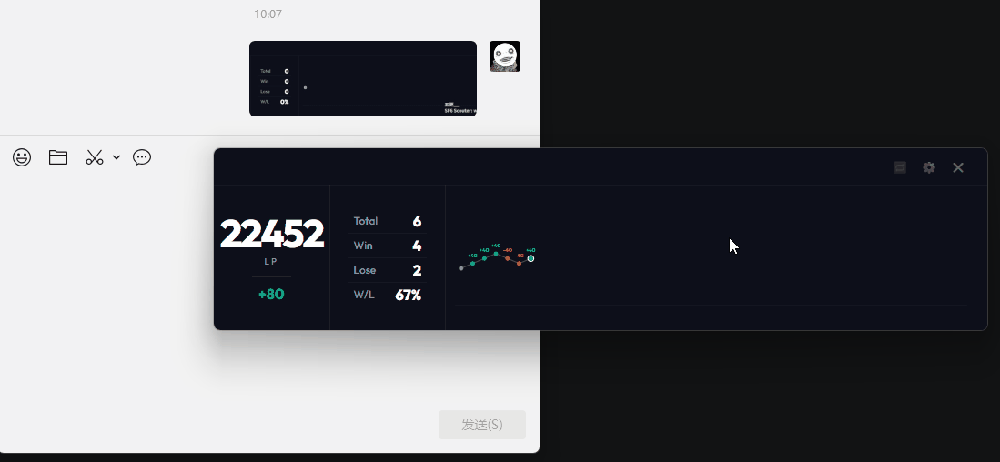

- **Pro支持自定义布局**：用户现在可以在设置-外观页面自定义Pro视图的布局，以更好地满足个人需求。
  🙌 特别感谢 NGA @就会玩治疗 提供的建议
  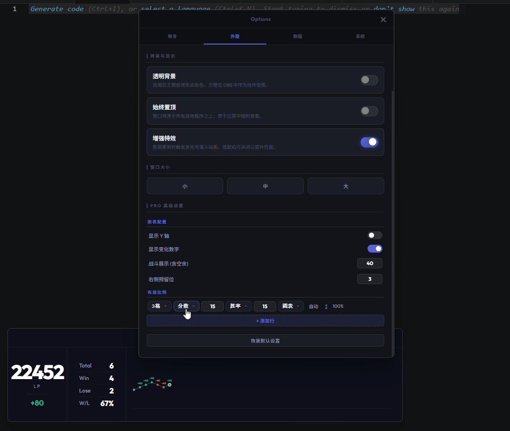

- **视图支持大/中/小快速设置**：用户现在可以在设置-外观页面快速选择视图大小（大/中/小），实现开箱即用。
  🙌 特别感谢 NGA @AinJianke 提供的建议
  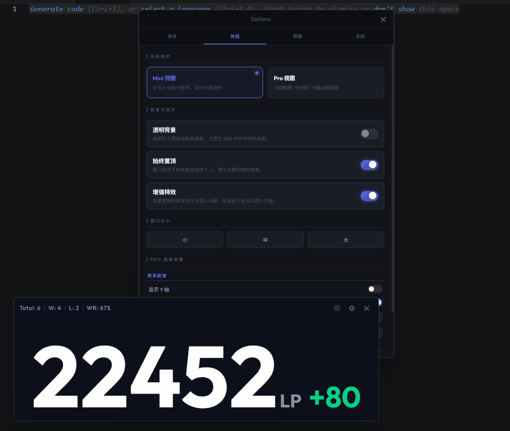

### 优化
- **新版本提醒页面排版优化**：优化新版本提醒页面的排版和样式，使其更清晰易读。

### 修复
- **启动后界面显示异常**：修复了在某些系统配置下，应用启动后界面无法正常显示的问题。
  🙌 特别感谢 QQ @墨昀uuuun 提供的反馈

## [0.3.0] - 2026-04-08

### 新增
- **设置功能独立窗口**：设置功能现在在独立窗口中打开，提供更专注的配置体验。
  🙌 特别感谢 NGA @AinJianke 提供的建议

- **提供查看各个角色数据功能**：用户现在可以在设置-数据页面查看当前角色跟踪角色和各个角色的数据
  🙌 特别感谢 NGA @AinJianke 提供的建议

- **添加Mini和Pro快速切换按钮**：在视图右上角添加了一个切换按钮，允许用户在 Mini 模式和 Pro 模式之间快速切换，无需进入设置。
  🙌 特别感谢 NGA @AinJianke 提供的建议

- **提供设置数据间隔配置**：用户现在可以设置-用户页面自定义数据刷新间隔，以优化性能和体验。
  🙌 特别感谢 QQ @宇宙最酷 提供的建议

- **对战记录持久化**：用户现在可以在设置-数据页面启用对战记录持久化，应用现在支持将战绩数据持久化存储，重启应用后数据不会丢失。(预览功能：新版本可能会造成持久化数据丢失)
  🙌 特别感谢 QQ @宇宙最酷 提供的建议

- **对战记录截取**：用户现在可以在设置-数据页面启用对战记录截取，自主选择从哪一场对战开始跟踪。
  🙌 特别感谢 QQ @宇宙最酷 提供的建议

- **新增新版本提醒功能**：当有新版本发布时，应用进行提醒，点击后可查看更新详情并选择立即更新或稍后提醒。

### 优化
- **优化角色切换**：优化角色切换逻辑，用户游戏中切换角色后，应用能更快地识别并切换到正确的 LP/MR 数据显示。
  🙌 特别感谢 NGA @AinJianke 提供的建议

## [0.2.3] - 2026-04-07

### 新增
- **自动切换LP/MR**：根据玩家的当前角色是否是大师,自动切换 LP 和 MR 数据显示。
  🙌 特别感谢 NGA @AinJianke 和 QQ @宇宙最酷 提供的建议
  🙌 特别感谢 QQ 用户 @宇宙最酷 提供的测试

## [0.2.2] - 2026-04-06

### 修复
- **修复**：修复无法跟踪豪鬼、拜森、本田的 LP 和 MR 数据的问题。
  🙌 特别感谢 QQ 用户 @balance，@宇宙最酷 提供的反馈和测试

## [0.2.1] - 2026-04-03

### 新增
- **跨 ID 追踪**：登录后支持追踪并切换其他玩家的 ID 战绩。
  🙌 特别感谢 NGA @丧心病狂的追忆 提供的建议

- **Pro 面板**：新增专业战绩面板，以动态折线图形式直观展示分数走势。
  🙌 特别感谢 NGA @gjf779, @丧心病狂的追忆, @AinJianke 提供的建议

- **窗口记忆**：支持自动记忆窗口配置，重新打开时将自动还原至上次关闭时的精确位置和大小。
  🙌 特别感谢 NGA @就会玩治疗 提供的建议

- **视觉增强**：为数字更新添加滚动特效。

## [0.1.35] - 2026-03-29

### 优化
- **重构追踪代码**：重构代码结构，提高可读性和可维护性。

- **UI 调整**：微调 UI 并修复了一些小 Bug。
