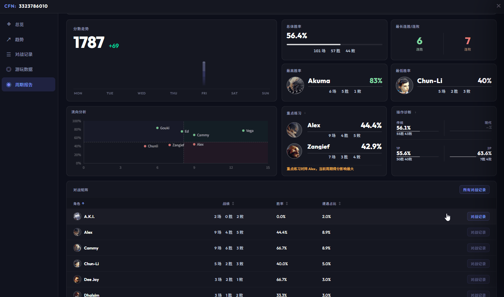
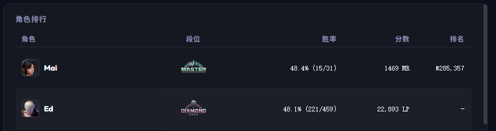
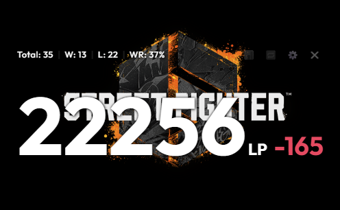

# 0.3.11 - 2026-05-22

### 追加

- **対戦詳細画面にランク別勝率を追加**: 週次レポート→対戦詳細画面に、LP差別・ランク帯別の対戦相手に対する勝率を追加しました。ユーザーは異なるLP差・ランク帯の相手に対する自分のパフォーマンスをより直感的に把握できます。また前週同期比の勝率も表示し、勝率の変化トレンドを確認できます。データをより深く理解するための総合的なアドバイスも提供します。
  
  🙌 ご提案くださった QQ 看不腻的唐、QQ 宇宙最强、QQ绯木 に特別な感謝を

- **プレイデータ画面に勝率情報を追加**: プレイデータ画面に勝率と対戦数の情報を追加しました。相手のゲームパフォーマンスをより直感的に把握できます。
  

- **K線図のカラー切替スイッチを追加**: K線図ページで上昇・下降のカラーを切り替えられるようになりました。緑上昇・赤下降、または赤上昇・緑下降の2パターンから選択できます。
  🙌 ご提案くださった QQ 觿子 に特別な感謝を

- **ボーダーレス透過モードを追加**: 設定→外観からボーダーレス透過モードを有効にできます。有効にするとパネルがボーダーレス・透過になり、より没入感のある使用体験を提供します。
  🙌 ご提案くださった WeChat Zn4n、WeChat Naoto に特別な感謝を
  

- **「SF6 Scouter をもっと賢くする」機能を強化**: 「SF6 Scouter をもっと賢くする」スイッチをオンにすると、今回の対戦記録がOCRモデルのトレーニングにも使用されるようになりました。モデルの精度と適応性を向上させ、今後の機能開発に備えます。

### 削除
- **周次レポートの対戦マトリクスからスコア変動情報を削除**: ユーザーのフィードバックにより、対戦マトリクス内のスコア変動情報は実際には意味がないと判断され、削除しました。
  🙌 フィードバックをくださった QQ绯木、QQ @宇宙最酷 に特別な感謝を
