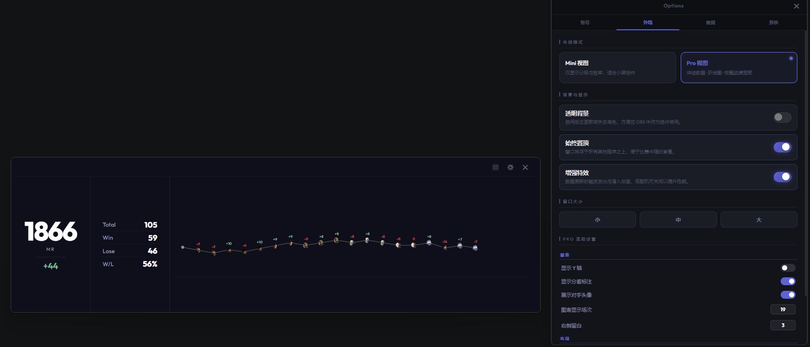
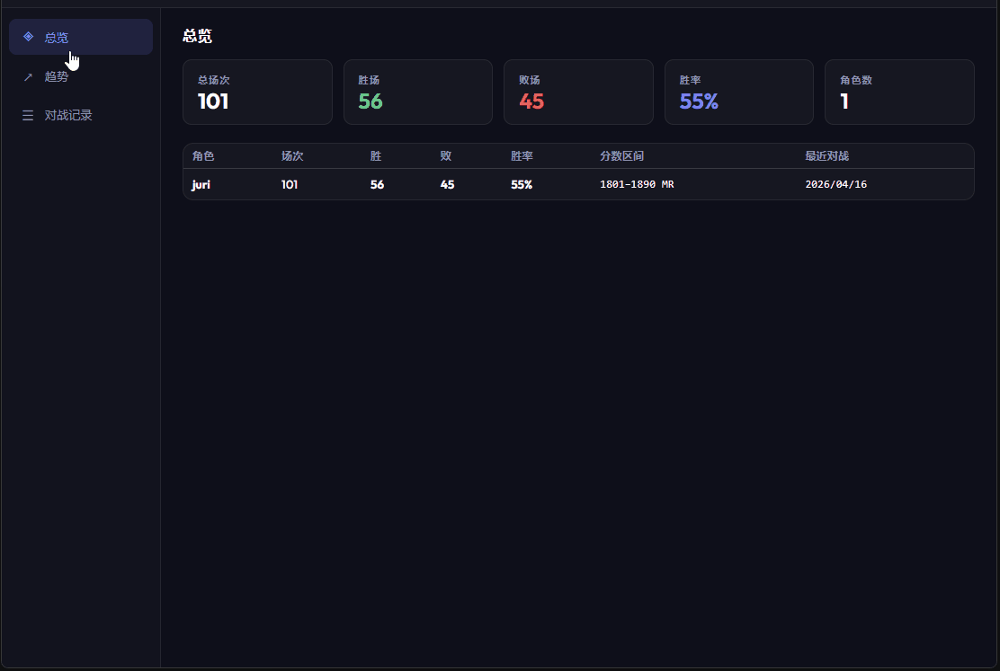

# 0.3.3 - 2026-04-16

### 新增
- **Pro面板显示对手头像**：用户可以在设置-外观-图表开启展示对手头像功能，在Pro视图中显示对手的头像，提升用户体验。
  🙌 特别感谢 QQ @宇宙最酷 提供的建议
  

- **数据分析面板**: 用户可以在设置-数据-数据分析打开数据分析面板，查看简易的分数趋势，胜率，K线图等
  🙌 特别感谢 NGA @AinJianke 提供的建议
  

- **正式支持持久化**：目前自动爬取用户最近100场对战数据并持久化存储，重启应用后数据不会丢失，并且在设置-系统配置备份文件夹位置，通过借助U盘，云盘等方式可实现数据备份。官网因版本更新导致的对战数据不展示，用户可以通过该持久化功能将数据保留在本地。并且使用加密措施，保证用户数据安全。
  🙌 特别感谢 QQ @宇宙最酷, QQ @墨昀uuuun, QQ @Jesusleo 提供的建议

### 优化
- **优化登录逻辑**：优化登录流程，提升登录体验和稳定性。

- **优化恢复会话**：将预览版数据持久化功能的恢复会话功能优化并支持当前正式持久化功能。

### 删除
- **删除预览版本数据持久化功能**：由于正式持久化功能的引入，原有的预览版本数据功能已不再必要，因此被移除。
