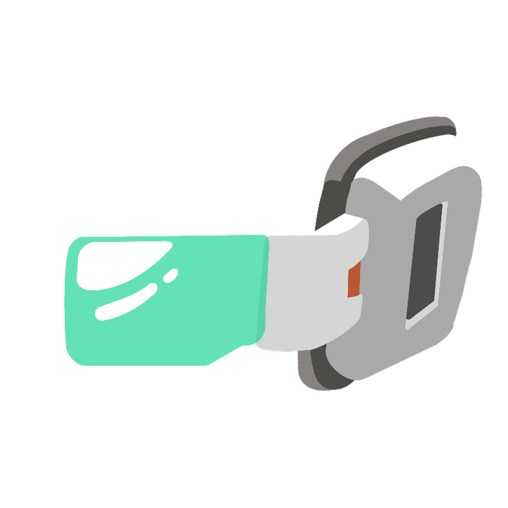
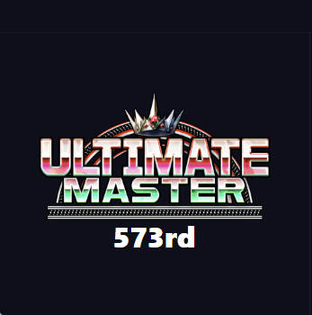
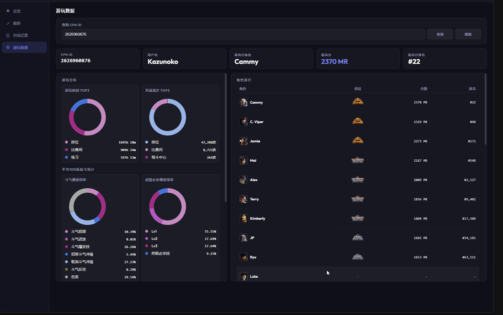
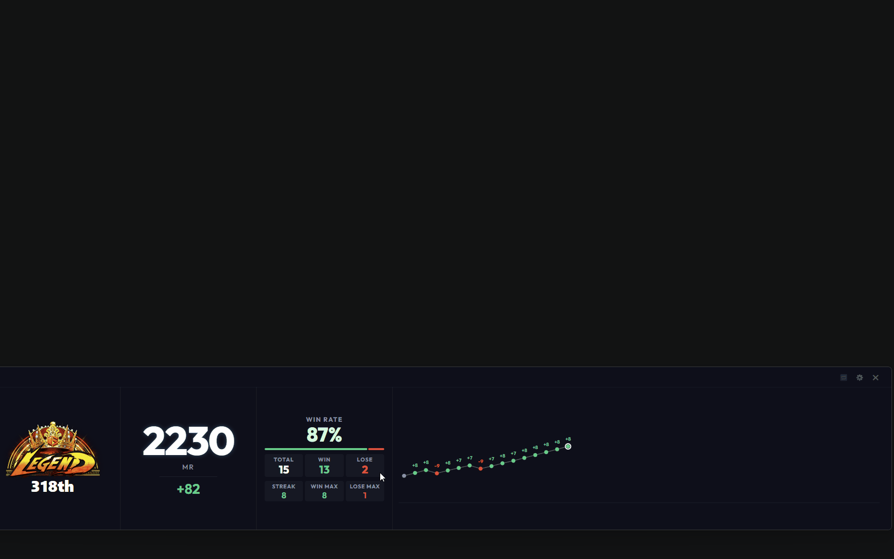
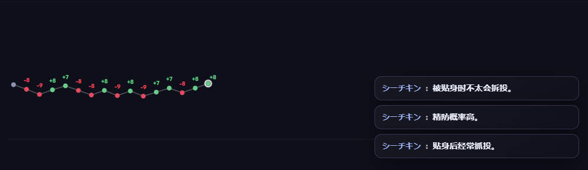
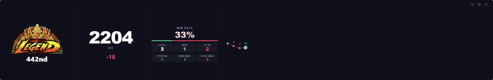

# 0.3.5 - 2026-04-23

### 新增
- **添加Logo**：在应用程序和官网中添加了一个新的Logo，以提升用户识别度。
  🙌 特别感谢 QQ 宇宙最酷 无偿提供的Logo
  

- **Pro面板添加段位视图**：用户可以在设置-外观-布局中选择段位视图，即可在Pro视图中显示段位和排名，提升用户体验。
  🙌 特别感谢 QQ Jesusleo, QQ 宇宙最酷 提供的建议
  

- **数据分析面板添加游玩数据页**：用户可以在设置-数据-数据分析-游玩数据查询用户的游玩数据,包含角色段位，游戏时长，格斗成就等数据。
  🙌 特别感谢 NGA AinJianke, QQ 宇宙最酷, 小黑盒 ghetto 提供的建议
  

- **Pro面板的数据点支持查看对手数据**：用户可以点击Pro视图中的数据点，快速查看对手数据，并且可以直接跳转到游玩数据页面。
  🙌 特别感谢 QQ 宇宙最酷 提供的建议
  

- **预览功能-对战结束后提供对手行为画像**：在首次和对手对战结束后，将提示对手的行为画像，帮助用户更好地了解对手习惯，用户可以在设置-数据-对手画像选项关闭该功能。
  🙌 特别感谢 QQ 宇宙最酷 提供的建议
  

### 优化
- **Pro视图Y轴段位显示优化**：放大Y轴段位图片，停止负数展示，提升可读性。
  🙌 特别感谢 微信 HENRY, QQ 宇宙最酷 提供的建议

- **添加段位视图作为Pro视图默认布局**：添加段位视图到Pro视图默认布局，提升用户体验。
  

### 修复
- **部分场景下抢夺窗口焦点**：修复了在某些特定场景下，强制抢夺窗口焦点的问题。
  🙌 特别感谢 QQ 宇宙最酷 提供的反馈
