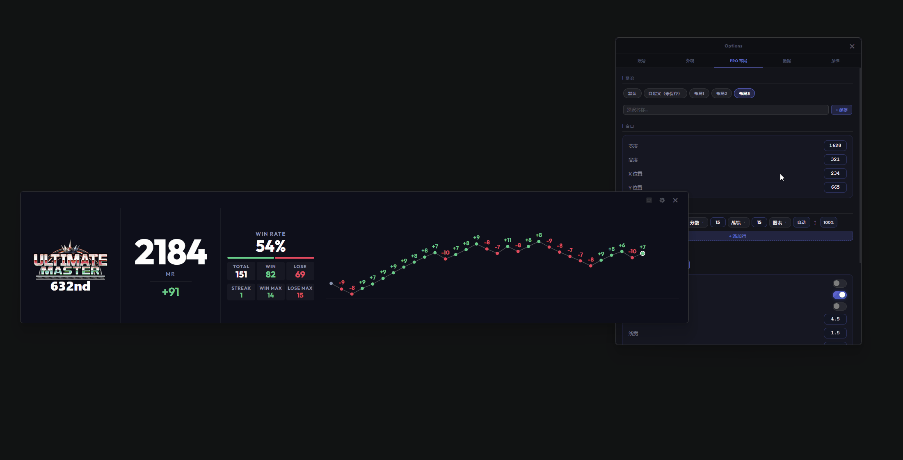

# 0.3.6 - 2026-04-26

### 新增
- **新增Pro布局功能**：用户现在可以在设置-Pro布局高度自定义Pro视图中不同模块的显示，并保存，后续可以一键还原。
  🙌 特别感谢 QQ memory, QQ 宇宙最酷 提供的建议
  

- **新增设置用户画像提示时长功能**：用户现在可以在设置-数据设置中调整对手画像提示的显示时长。
 🙌 特别感谢 QQ Hinako 提供的建议

### 优化
- **Pro视图弹窗位置优化**：优化了Pro视图中弹窗的位置，使其显示更加合理，避免遮挡主要内容。
  🙌 特别感谢 QQ 宇宙最酷 提供的建议
