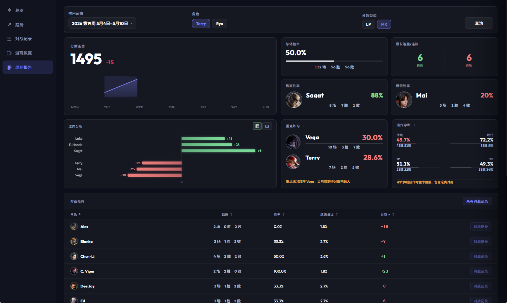

# 0.3.7 - 2026-05-06

### Added
- **Weekly Report Feature**: Users can now view a weekly match summary and analysis from Settings > Data Analysis > Weekly Report to better understand their performance and trends. The report is generated from data collected by this tool, so it may be incomplete if the tool has not been used to capture data for a long time.
  🙌 Special thanks to QQ 第一百零五天 for the suggestion
  

- **Data Analysis Shortcut Entry**: Added a shortcut to the Data Analysis window in the top-right corner of both the Mini and Pro panels for quicker access.

- **Rank Module Customization**: Users can now customize the display style of the rank module from Settings > Pro Layout for a more personalized layout.
  🙌 Special thanks to QQ @宇宙最酷 for the suggestion

### Improved
- **Tracking Now Records Ranked Matches Only**: Refined the tracking logic so that only ranked-match data is recorded, providing a more focused ranked-climb tracking experience.
  🙌 Special thanks to 小黑盒 李某某 for the suggestion

- **Improved Score Module Display**: Improved the score module display to ensure it renders properly across different resolutions and avoids clipped numbers.
  🙌 Special thanks to QQ @星离雨散 for the suggestion

### Fixed
- **Play Data Ranking Issue**: Fixed an issue where rankings for non-Master users were displayed incorrectly on the Play Data page, ensuring ranking information is shown accurately.
  🙌 Special thanks to QQ @宇宙最酷 for the feedback

- **Panel Window Coordinate Errors After Layout Changes**: Fixed an issue where coordinate data could become incorrect after changing a panel window's position or size, ensuring dragged window positions are recorded correctly.
  🙌 Special thanks to QQ @宇宙最酷 for the feedback
