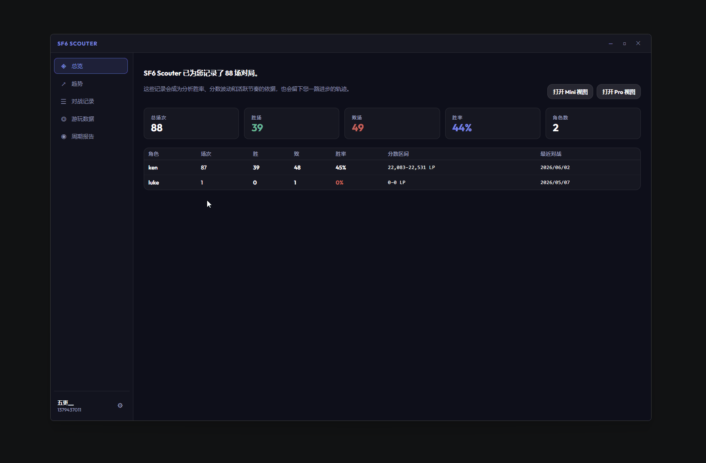

# 0.4.0 - 2026-06-03

### 追加

- **上振れ・連敗防止アシスタントを追加**: 短時間で連続して複数試合に敗北した場合、休憩を促す通知ウィンドウを表示し、熱くなって連続でポイントを失うことを防ぎます。
  🙌 ご提案くださった QQ 看不腻的唐、QQ 第一百零五天、QQ 踢、QQ 绯木 に特別な感謝を

- **ゲーム起動時のビュー自動表示を追加**: ゲームの起動を検出すると、Mini または Pro ビューを自動で表示できるようになり、ユーザーの操作手順を減らします。この機能は、設定 > システム > アプリ動作 から無効化できます。
  🙌 インスピレーションをくださった QQ Kano に特別な感謝を
    
    

- **システムトレイ機能を追加**: アプリ起動後、システムトレイに最小化できるようになりました。トレイアイコンの右クリックメニューから、メイン画面、Mini パネル、Pro パネルを素早く開いたり、アプリを終了したりできます。

- **スタートアップ起動機能を追加**: 設定 > システム からスタートアップ起動を有効化できます。有効にすると、システム起動時にアプリが自動的に実行され、手動で起動する必要がなくなります。

### 改善

- **ウィンドウ操作ロジックを改善**: ホームウィンドウを導入し、従来のウィンドウ機能を統合・最適化することで、ユーザー体験を向上しました。ホームウィンドウはアプリ起動後の主要な操作入口となり、各機能へより分かりやすくアクセスできます。また、ウィンドウ間の切り替えロジックも改善し、各機能モジュール間をより自然かつスムーズに移動できるようになりました。
  🙌 フィードバックをくださった QQ aaa 乐 に特別な感謝を

- **プロキシダウンロードを最適化**: 公式サイトおよびアプリ内のプロキシダウンロード機能を最適化し、ダウンロード速度と安定性を向上しました。ユーザーがより速く安定してアプリをダウンロードできるようになります。
  🙌 フィードバックをくださった QQ 风、QQ 宇宙最酷、QQ 蠹、QQ 林无穷、WeChat kumoito、WeChat HENRY に特別な感謝を

- **周期レポートが最新スコアに対応**: 周期レポート内のスコア情報が、ユーザーの現在の最新スコアに対応しました。現在のスコアと推移をより正確に把握できます。
  🙌 フィードバックをくださった QQ 宇宙最酷、NGA 智障的最高境界、小黑盒 Art0r1as に特別な感謝を

- **「SF6 Scouter をもっと賢くする」機能の内容を追加**: 「SF6 Scouter をもっと賢くする」スイッチをオンにすると、今後の機能開発のためにプレイヤーのプレイデータがアップロードされます。

### 修正
- **ウィンドウを閉じてもアプリが完全に終了しない問題を修正**: ウィンドウを閉じた後もアプリがバックグラウンドで動作し続ける問題を修正し、ユーザーがウィンドウを閉じた後にアプリが完全に終了してシステムリソースを解放できるようにしました。
  🙌 フィードバックをくださった QQ 宇宙最酷、GitHub Yuck1125 に特別な感謝を

### 削除
- **Mini ウィンドウと Pro ウィンドウの設定入口を削除**: 画面設計をシンプルにするため、Mini ウィンドウと Pro ウィンドウ内の設定入口を削除しました。現在の設定入口はホームウィンドウ左下にあります。
