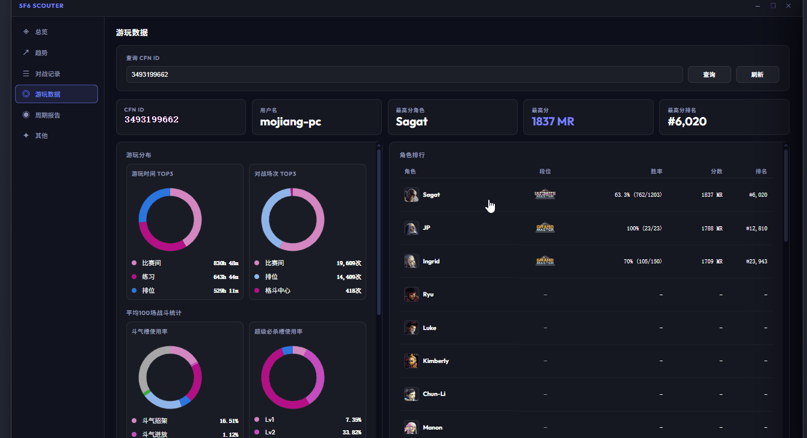
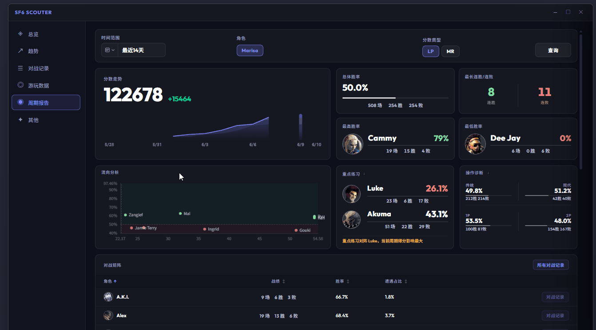
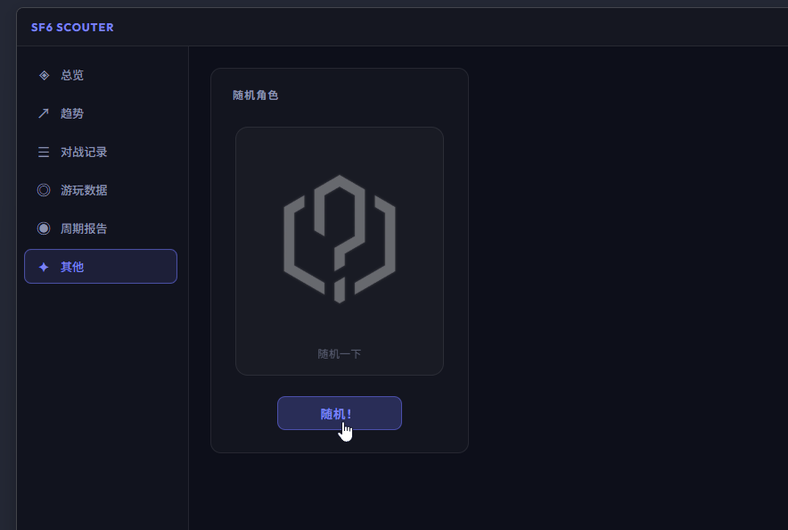
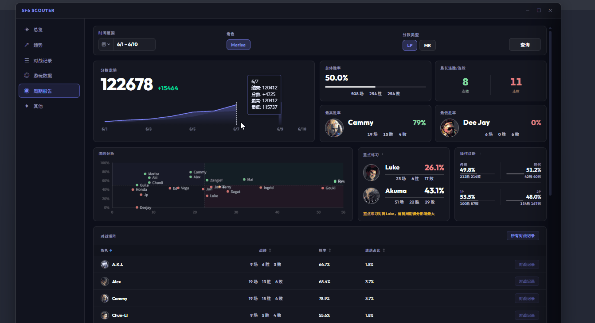

# 0.4.1 - 2026-06-10

### 添加

- **游玩数据支持查看对战胜率**: 在“Home-游玩数据”中点击特定角色，即可查看该角色对战其他各角色的胜率。
  
- **新增网络连接测试**: 在“设置-账号”中添加网络测试功能，可检测当前环境与官网的连接质量，协助诊断网络问题。
  🙌 特别感谢 QQ 宇宙最酷 提供的建议

- **Home 页面支持缩放**：用户可以使用 `Ctrl + 滚轮` 来放大或缩小页面，提升交互体验。
  🙌 特别感谢 QQ 此路<-不通 提供的建议
  

- **新增随机角色推荐**：在“Home-其他”页面中点击“随机角色”按钮即可获得推荐。该功能各角色出现概率均等。
  🙌 特别感谢 QQ 王小川 提供的建议
  

### 优化

- **周期报表支持自定义时间查询**：支持自定义时间范围查找，满足不同场景下的查询需求（单次查询跨度最大为 30 天）。
  🙌 特别感谢 NGA 智障的最高境界, QQ 浅海 提供的反馈
  

- **DPI 适配优化**：优化了应用在高 DPI 屏幕上的显示效果，确保界面元素清晰且布局合理。
  🙌 特别感谢 QQ Kano 提供的反馈

- **Home 页面支持记忆上次选项**：自动记录侧边栏的上次选择，避免重复操作，提升使用体验。
  🙌 特别感谢 QQ 浅海, QQ❄ 提供的建议

### 修复
- **修复跟踪起点角色列表为空的问题**：解决了特定情况下跟踪起点角色列表显示为空的故障。
  🙌 特别感谢 QQ w158 提供的反馈
